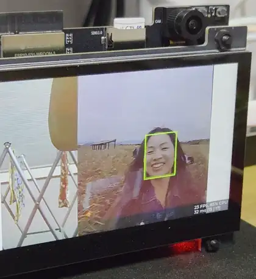
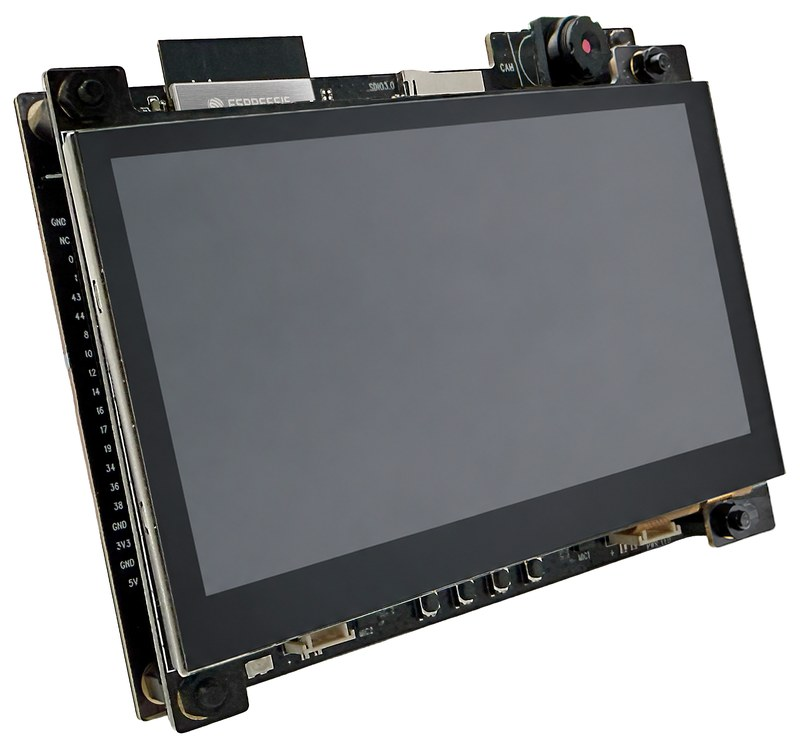
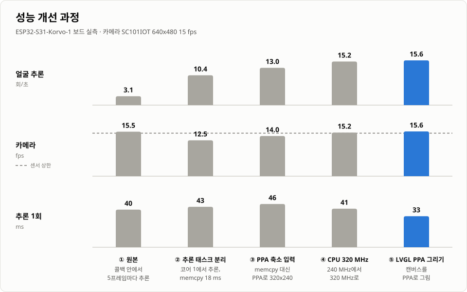
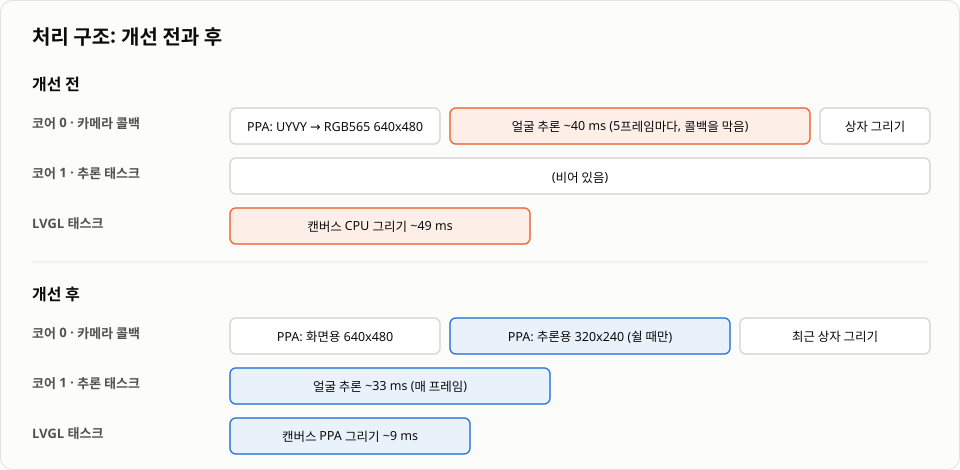
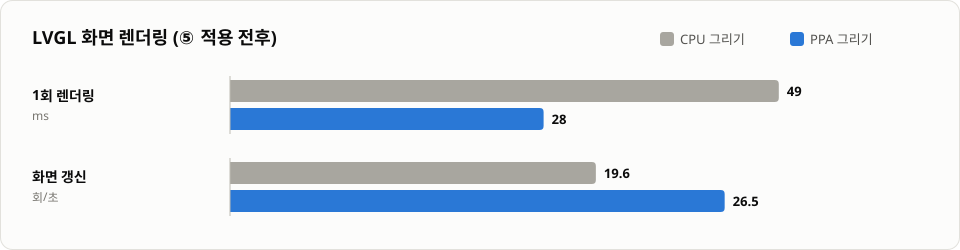
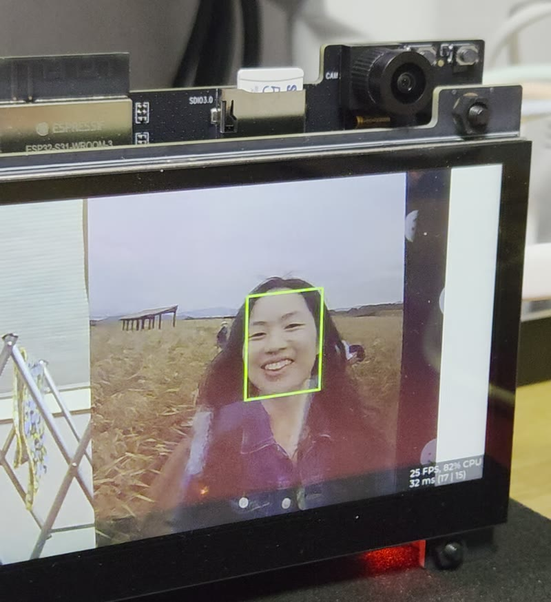

# ESP32-S31-Korvo-1 얼굴 검출 데모

[English](README_EN.md) | **한국어**

[](https://github.com/firepooh/ESP32S31-FACEDETECT/actions/workflows/build.yml)

ESP32-S31-Korvo-1 보드에서 카메라 영상을 LCD에 띄우고, ESP-DL로 얼굴을 찾아 초록색 상자를 그리는 데모다.
Espressif 워크숍 [Assignment 7](https://developer.espressif.com/workshops/introduction-to-esp32-s31-with-vision/assignment-7/)을 바탕으로 성능을 개선해, 매 프레임 얼굴을 찾는다.

<table>
  <tr>
    <td align="center" width="50%"><br><sub>동작 영상 · <a href="docs/media/demo.mp4">MP4로 보기</a></sub></td>
    <td align="center" width="50%"><br><sub>ESP32-S31-Korvo-1 (사진: <a href="https://docs.espressif.com/projects/esp-dev-kits/en/latest/esp32s31/esp32-s31-korvo-1/user_guide.html">Espressif</a>)</sub></td>
  </tr>
</table>

### **[▶ 웹 플래셔 열기](https://firepooh.github.io/ESP32S31-FACEDETECT/)** — 빌드 도구 없이 브라우저에서 바로 펌웨어를 올린다.

## 성능

| 항목 | 워크숍 원본 | 이 저장소 |
|---|---|---|
| 카메라 | 15.5 fps | 15.6 fps |
| 얼굴 추론 | 초당 약 3회 (5프레임마다) | **초당 약 15.6회 (매 프레임)** |
| 추론 1회 | 약 40 ms | 약 33 ms |
| LVGL 화면 1회 렌더링 | 약 49 ms | 약 28 ms |

보드에서 잰 값이다. 카메라는 SC101IOT, 640x480 15 fps 설정이다.

## 성능 개선 과정



| 단계 | 바꾼 내용 | 결과 |
|---|---|---|
| ① 원본 | 카메라 콜백 안에서 5프레임마다 추론한다 | 상자가 약 0.3초마다만 움직인다 |
| ② 추론 태스크 분리 | 추론을 코어 1의 별도 태스크로 옮기고, 쉬고 있을 때만 새 프레임을 넘긴다 | 추론이 초당 10회로 늘었지만, 614 KB `memcpy`(18 ms) 때문에 카메라가 12.5 fps로 떨어진다 |
| ③ PPA 축소 입력 | 복사 대신 PPA 하드웨어로 추론용 320x240 축소본을 만든다 | 카메라 14 fps, 추론 초당 13회 |
| ④ CPU 320 MHz | S3 예제에서 가져온 240 MHz 설정을 S31 기본값 320 MHz로 바꾼다 | 카메라 15.2 fps, 추론 초당 15회 |
| ⑤ LVGL PPA 그리기 | LVGL 9.5의 PPA 그리기로 카메라 캔버스를 그린다 | 렌더링 49 → 28 ms, 추론 1회 41 → 33 ms |





자세한 측정 과정과 ESP32-S31에서 LVGL PPA를 쓰기 위한 설정은 [DEMO_KO.md](DEMO_KO.md)에 정리했다.
그림은 `python docs/make_charts.py`로 다시 만들 수 있다.

## 준비물

- ESP32-S31-Korvo-1 보드 (SC101IOT 카메라, 800x480 RGB LCD)
- USB Type-C 케이블 (보드의 UART 포트에 연결)

## 펌웨어 올리기

### 방법 1: 웹 플래셔 (권장)

1. 데스크톱 Chrome 또는 Edge로 [웹 플래셔](https://firepooh.github.io/ESP32S31-FACEDETECT/)를 연다.
2. 보드의 UART 포트를 PC에 연결한다. 그 포트를 연 시리얼 터미널이 있으면 먼저 닫는다.
3. **Connect & Flash**를 누르고 CP210x 포트를 고른다.

ESP Web Tools는 아직 ESP32-S31을 지원하지 않는다. 그래서 S31을 지원하는 esptool-js 0.7.1로 웹 플래셔를 직접 만들었다.
`main` 브랜치에 push할 때마다 GitHub Actions가 펌웨어를 빌드해 웹 플래셔에 올린다.

### 방법 2: 빌드된 바이너리를 esptool로

[Actions](https://github.com/firepooh/ESP32S31-FACEDETECT/actions/workflows/build.yml)의 빌드 결과물이나 웹 플래셔 페이지에서 병합 바이너리를 받는다.

```bash
esptool --chip esp32s31 -p COMxx -b 460800 --no-stub write-flash 0x0 display_camera_new-esp32s31-merged.bin
```

### 방법 3: 직접 빌드

ESP-IDF v6.1이 필요하다. ESP32-S31은 프리뷰 타깃이라 `--preview`를 붙인다.

```bash
idf.py --preview set-target esp32s31
idf.py --preview build
idf.py --preview -p COMxx flash monitor
```

## 정상 동작 확인



- LCD에 카메라 영상이 나오고, 얼굴에 초록색 상자가 그려진다.
- 오른쪽 아래에 LVGL 성능 표시(FPS, CPU 사용률)가 나온다.
- 시리얼 로그(115200 bps)에 5초마다 아래와 같은 줄이 찍힌다.

```
I (17052) face_detect: camera 15.4 fps, inference 15.4 /s (avg 33 ms, input 320x240), faces=1
I (17052) face_detect: face score=0.98 box=[332,142,508,390]
```

## CI와 웹 플래셔 구성

| 파일 | 역할 |
|---|---|
| `.github/workflows/build.yml` | `espressif/idf:v6.1` 컨테이너에서 빌드하고, `main`이면 GitHub Pages에 배포한다 |
| `tools/make_web_flasher.py` | `build/flasher_args.json`을 읽어 바이너리, `manifest.json`, 병합 바이너리를 만든다 |
| `web/` | 웹 플래셔 페이지 (`index.html`, `flasher.js`, `style.css`) |

웹 플래셔를 로컬에서 시험하려면 빌드한 뒤 아래처럼 띄운다.

```bash
python tools/make_web_flasher.py --build-dir build --web-dir web --out-dir _site
python -m http.server 8765 --directory _site
```

## 문서

- [DEMO_KO.md](DEMO_KO.md): 원본 예제에서 바꾼 부분, 성능 개선 과정, 문제 해결
- [LVGL_VERSION_KO.md](LVGL_VERSION_KO.md): LVGL 버전 충돌과 해결 방법

## 출처

- Espressif BSP 예제 `display_camera_video` (BSP 1.1.0)
- [ESP-DL](https://github.com/espressif/esp-dl) `human_face_detect` 0.5.0
- [esptool-js](https://github.com/espressif/esptool-js)
- 보드 사진: [ESP32-S31-Korvo-1 사용자 가이드](https://docs.espressif.com/projects/esp-dev-kits/en/latest/esp32s31/esp32-s31-korvo-1/user_guide.html)
