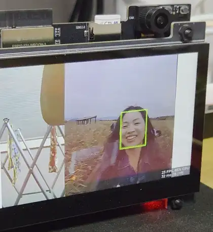
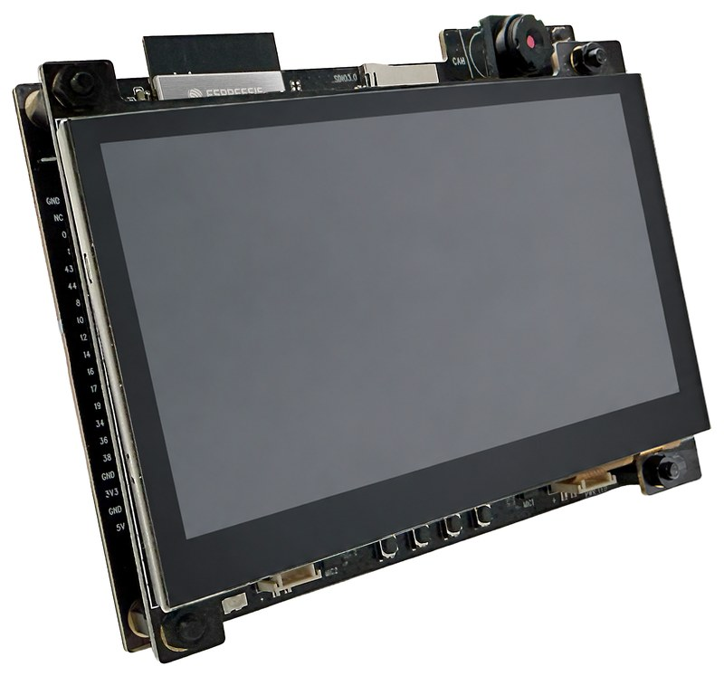
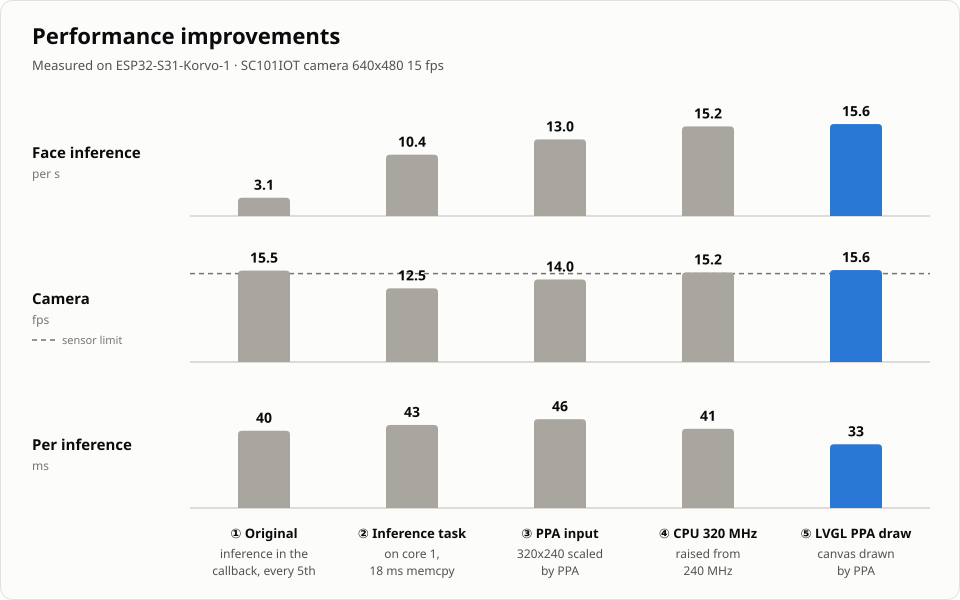
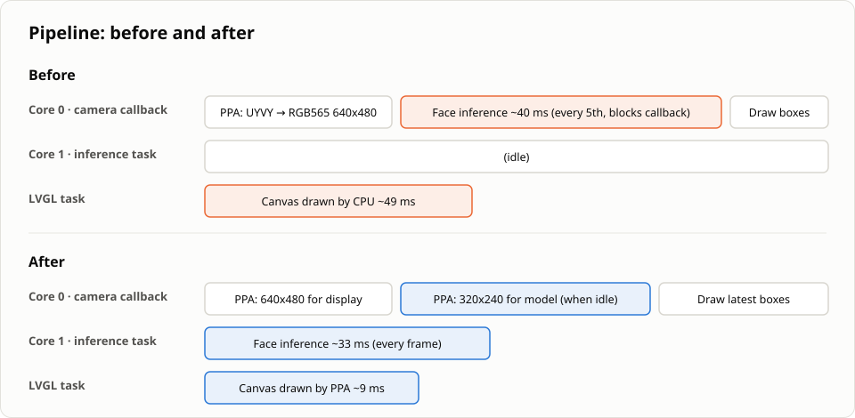
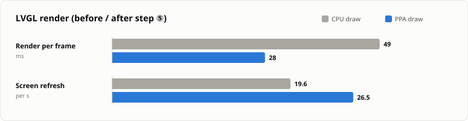
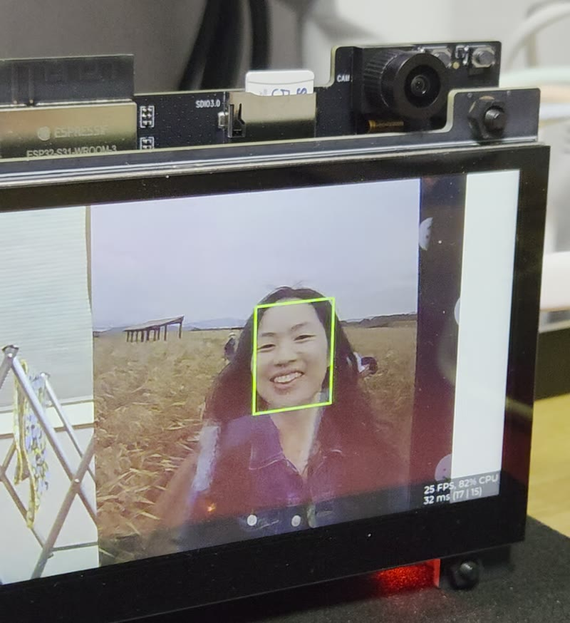

# ESP32-S31-Korvo-1 Face Detection Demo

**English** | [한국어](README.md)

[](https://github.com/firepooh/ESP32S31-FACEDETECT/actions/workflows/build.yml)

Camera-to-LCD demo for the ESP32-S31-Korvo-1 board. ESP-DL finds faces in the live image and draws a green box around each one.
It is based on Espressif workshop [Assignment 7](https://developer.espressif.com/workshops/introduction-to-esp32-s31-with-vision/assignment-7/), tuned so that face detection runs on every frame.

<table>
  <tr>
    <td align="center" width="50%"><br><sub>Demo · <a href="docs/media/demo.mp4">watch as MP4</a></sub></td>
    <td align="center" width="50%"><br><sub>ESP32-S31-Korvo-1 (photo: <a href="https://docs.espressif.com/projects/esp-dev-kits/en/latest/esp32s31/esp32-s31-korvo-1/user_guide.html">Espressif</a>)</sub></td>
  </tr>
</table>

### **[▶ Open the web flasher](https://firepooh.github.io/ESP32S31-FACEDETECT/)** — flash the firmware from your browser, no toolchain needed.

## Performance

| Item | Workshop original | This repository |
|---|---|---|
| Camera | 15.5 fps | 15.6 fps |
| Face inference | ~3 per second (every 5th frame) | **~15.6 per second (every frame)** |
| Per inference | ~40 ms | ~33 ms |
| LVGL render per frame | ~49 ms | ~28 ms |

Measured on the board. Camera: SC101IOT at 640x480, 15 fps.

## How it got faster



| Step | Change | Result |
|---|---|---|
| ① Original | Inference inside the camera callback, every 5th frame | Boxes move only about every 0.3 s |
| ② Inference task | Move inference to its own task on core 1; hand over a frame only when it is idle | 10 inferences/s, but a 614 KB `memcpy` (18 ms) drops the camera to 12.5 fps |
| ③ PPA input | Let the PPA hardware scale a 320x240 copy for the model instead of copying | Camera 14 fps, 13 inferences/s |
| ④ CPU 320 MHz | Replace the 240 MHz setting copied from an ESP32-S3 example with the ESP32-S31 default of 320 MHz | Camera 15.2 fps, 15 inferences/s |
| ⑤ LVGL PPA draw | Draw the camera canvas with LVGL 9.5's PPA draw unit | Render 49 → 28 ms, inference 41 → 33 ms |





Measurement details and the settings needed to use LVGL's PPA draw unit on ESP32-S31 are in [DEMO_KO.md](DEMO_KO.md) (Korean).
Regenerate the images with `python docs/make_charts.py`.

## Hardware

- ESP32-S31-Korvo-1 board (SC101IOT camera, 800x480 RGB LCD)
- USB Type-C cable to the board's UART port

## Flashing

### Option 1: Web flasher (recommended)

1. Open the [web flasher](https://firepooh.github.io/ESP32S31-FACEDETECT/) in desktop Chrome or Edge.
2. Connect the board's UART port. Close any serial monitor that holds the port.
3. Click **Connect & Flash** and pick the CP210x port.

ESP Web Tools does not support ESP32-S31 yet, so the web flasher is built directly on esptool-js 0.7.1, which does.
Every push to `main` builds the firmware with GitHub Actions and publishes it to the web flasher.

### Option 2: Prebuilt binary with esptool

Download the merged binary from the [Actions](https://github.com/firepooh/ESP32S31-FACEDETECT/actions/workflows/build.yml) artifacts or from the web flasher page.

```bash
esptool --chip esp32s31 -p COMxx -b 460800 --no-stub write-flash 0x0 display_camera_new-esp32s31-merged.bin
```

### Option 3: Build from source

Requires ESP-IDF v6.1. ESP32-S31 is a preview target, so pass `--preview`.

```bash
idf.py --preview set-target esp32s31
idf.py --preview build
idf.py --preview -p COMxx flash monitor
```

## Expected behavior



- The LCD shows the live camera image, with a green box on each face.
- The LVGL performance monitor (FPS, CPU load) appears in the bottom-right corner.
- The serial log (115200 bps) prints a line like this every 5 seconds:

```
I (17052) face_detect: camera 15.4 fps, inference 15.4 /s (avg 33 ms, input 320x240), faces=1
I (17052) face_detect: face score=0.98 box=[332,142,508,390]
```

## CI and web flasher

| File | Purpose |
|---|---|
| `.github/workflows/build.yml` | Builds in the `espressif/idf:v6.1` container and deploys to GitHub Pages on `main` |
| `tools/make_web_flasher.py` | Reads `build/flasher_args.json` and writes the images, `manifest.json` and a merged binary |
| `web/` | Web flasher page (`index.html`, `flasher.js`, `style.css`) |

To try the web flasher locally after a build:

```bash
python tools/make_web_flasher.py --build-dir build --web-dir web --out-dir _site
python -m http.server 8765 --directory _site
```

## Documents (Korean)

- [DEMO_KO.md](DEMO_KO.md): changes from the original example, performance work, troubleshooting
- [LVGL_VERSION_KO.md](LVGL_VERSION_KO.md): LVGL version conflict and the fix

## Credits

- Espressif BSP example `display_camera_video` (BSP 1.1.0)
- [ESP-DL](https://github.com/espressif/esp-dl) `human_face_detect` 0.5.0
- [esptool-js](https://github.com/espressif/esptool-js)
- Board photo: [ESP32-S31-Korvo-1 user guide](https://docs.espressif.com/projects/esp-dev-kits/en/latest/esp32s31/esp32-s31-korvo-1/user_guide.html)
